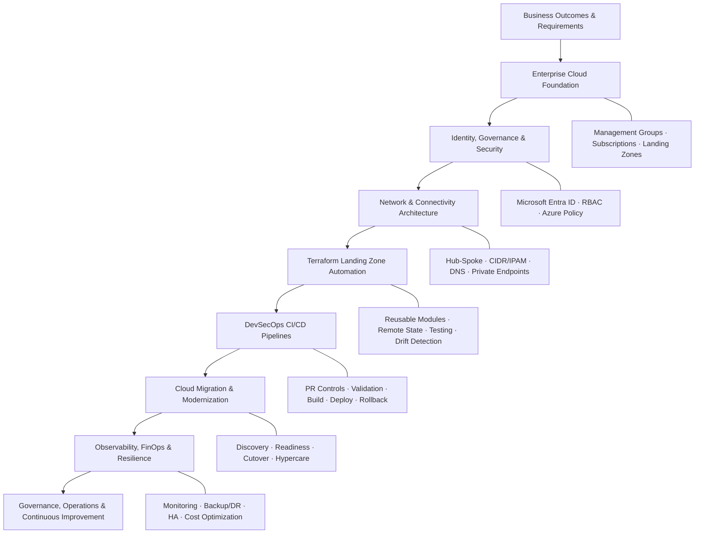

### DevOps Architect | Cloud-Native | Kubernetes | Telecom & IMS

*Automate intelligently. Architect for scale. Engineer for reliability.*

📍 Gurugram, India

---

## 👋 About Me

I'm **Vikrant Yadav**, a DevOps / Cloud-Native Architect with **16+ years of overall experience**, spanning DevOps engineering, cloud platforms, infrastructure automation, and telecom networks.

I specialize in designing and operating scalable cloud-native platforms, automating infrastructure, strengthening CI/CD pipelines, and improving reliability across production environments.

My unique combination of **DevOps architecture and telecom-domain expertise** enables me to work across cloud infrastructure, Kubernetes platforms, CNF/VNF deployments, IMS, and VoLTE solutions.

- ☁️ Multi-cloud architecture: AWS, Azure, and GCP
- ☸️ Kubernetes, Docker, Helm, EKS, AKS, GKE, and OpenShift
- 🏗️ Infrastructure as Code with Terraform and Ansible
- 🔄 CI/CD and GitOps automation
- 🔐 DevSecOps, security scanning, and compliance
- 📊 Observability, monitoring, and reliability engineering
- 📡 Telecom architecture: IMS, VoLTE, SIP, Diameter, DNS, and CNF/VNF

## 🛠️ Technology Stack

### Cloud & Infrastructure

### Containers & DevOps

### Scripting & Observability

| Category | Technologies |
|---|---|
| Cloud | AWS, Azure, GCP |
| AWS Services | EC2, Lambda, EKS, ECS, S3, EFS, RDS, DynamoDB, Aurora, Glue, Athena |
| Serverless | Lambda, Step Functions, EventBridge, API Gateway, SNS, SQS |
| Containers | Kubernetes, Docker, Helm, EKS, AKS, GKE, OpenShift |
| IaC & Automation | Terraform, Ansible, ARM templates |
| CI/CD & GitOps | Jenkins, GitHub Actions, GitLab CI/CD, Azure Pipelines, Argo CD |
| DevSecOps | SonarQube, Trivy, tfsec, TFLint, TruffleHog, IAM, RBAC |
| Monitoring | Prometheus, Grafana, ELK Stack, CloudWatch, CloudTrail |
| Scripting | Bash, YAML, Python (basic) |
| Telecom | IMS, VoLTE, SIP, Diameter, SS7, SIGTRAN, HSS/HLR, SBC, TAS, CNF/VNF |

## 🚀 What I Do

- **Cloud Architecture:** Design secure, scalable cloud-native and event-driven solutions.
- **Platform Engineering:** Build and troubleshoot Kubernetes-based platforms and deployments.
- **Infrastructure Automation:** Create repeatable infrastructure using Terraform and Ansible.
- **CI/CD Engineering:** Automate build, validation, testing, security checks, and releases.
- **DevSecOps:** Integrate security controls and scanning into delivery pipelines.
- **SRE & Observability:** Improve monitoring, incident investigation, and operational reliability.
- **Telecom Cloud Native:** Support CNF/VNF platforms, IMS/VoLTE services, and signaling integration.

## 🏛️ Enterprise Architecture & DevOps Architect Portfolio

The following architecture focus areas are based on my DevOps Architect portfolio framework, spanning business understanding, enterprise cloud foundations, secure implementation, migration, and ongoing operations.

### ☁️ Enterprise Cloud Foundation & Governance

- Design tenant, management group, subscription, platform and application boundaries.
- Plan subscription onboarding/offboarding, Azure Policy and initiative assignments, RBAC groups, and justified policy exemptions.
- Apply Cloud Adoption Framework (CAF) concepts across plan, ready, adopt, govern, secure and manage.
- Align architecture decisions with business requirements and operational needs.

### 🌐 Hub-and-Spoke Networking & Security

- Hub-and-spoke architecture, IP address management (IPAM), CIDR planning and on-premises network assessment.
- VNet peering, user-defined routes (UDRs), firewall rules and controlled egress.
- Private DNS zones, private endpoints, VPN Gateway and ExpressRoute.
- Security controls across identity, networking, governance and compute layers.

### 🧱 Terraform Landing Zone Automation

- Build reusable Terraform modules and repeatable landing-zone automation.
- Manage remote state with least-privilege access and encryption at rest.
- Integrate linting, testing, secret scanning, cost checks, manual approvals and pipeline-based drift detection.
- Promote infrastructure changes through controlled review and deployment workflows.

### 🔄 Azure DevOps & DevSecOps Pipelines

- Design pipeline stages and reusable templates for validation, testing, build, deployment, apply and rollback.
- Use protected main branches, code owners, mandatory pull requests, reviewer policies and short-lived feature branches.
- Integrate code quality, IaC security, image scanning and secret detection.
- Use parallel jobs and controlled promotion between environments where appropriate.

### 🚚 Cloud Migration & Application Modernization

- Support migration planning across development, UAT and production environments.
- Perform discovery, assessment, readiness reviews and dependency analysis.
- Plan pre-migration and post-migration checks, cutover, rollback readiness and hypercare.
- Consider hybrid environments spanning on-premises data centres and cloud workloads.

### 💰 FinOps, Backup, Disaster Recovery & Observability

- Review idle resources, unattached disks, oversized compute, unnecessary log ingestion and VM start/stop schedules.
- Assess reserved capacity and backup-retention settings.
- Plan high availability and disaster recovery using RTO/RPO requirements and suitable resilience options, including LRS, ZRS and GRS.
- Establish monitoring and observability using Azure Monitor and relevant platform monitoring tools.

### 🤝 Delivery Governance, Vendor Management & Team Enablement

- Define scope, deliverables, acceptance criteria, dependencies, risks, sprints and accountability.
- Contribute to RFI/RFP responses, technical evaluation matrices, architecture capability assessments and proposals.
- Establish escalation matrices, review cadences, deliverable sign-off and transition plans.
- Maintain documentation handover, RACI, SOPs and knowledge-transfer plans.
- Support team upskilling, technical interviews, KT sessions, workshops and proof of concepts.

## 📈 Career Highlights

- 🚀 **40% improvement in deployment speed** through container-based production deployments.
- 🔄 **50% reduction in release errors** through CI/CD automation.
- 🏗️ Automated infrastructure provisioning using Terraform and Ansible.
- 🔐 Implemented cloud security controls using IAM, KMS, Secrets Manager, and CloudTrail.
- 📡 Combined cloud-native engineering with extensive telecom and signaling experience.

*Achievement metrics are based on my professional resume.*

## 💼 Professional Experience

| Organization | Role | Period |
|---|---|---|
| Nokia Networks | Architect | Jan 2021 – Present |
| Ericsson India Global | Senior Solution Integrator | Sep 2019 – Jan 2021 |
| Aricent Technologies | Network Specialist | Apr 2018 – Sep 2019 |
| mCarbon Tech Innovations | Technical Lead | May 2016 – Apr 2018 |
| Earlier Telecom Roles | Engineering & Network Operations | 2010 onwards |

## 🎓 Certifications

- Certified Kubernetes Administrator (CKA)
- AWS Certified Solutions Architect – Associate
- Nokia CFX L4 Certification
- Nokia ZTS L4 Certification

## 🏆 Recognition

- Quarterly Excellence Award — DevSecOps transformation
- Client Appreciation Award — Cloud solutions and cost optimization
- Best Innovation Award — Infrastructure and CI/CD automation

## 📊 GitHub Activity

## 📌 What You'll Find Here

- 🏗️ Terraform modules and Infrastructure as Code
- ☸️ Kubernetes manifests, Helm charts, and deployment patterns
- 🔄 CI/CD pipelines and GitHub Actions workflows
- 🔐 DevSecOps automation and security integrations
- ☁️ Cloud architecture and automation examples
- 📊 Monitoring, observability, and reliability engineering
- 📡 Telecom and cloud-native technical notes

*Project availability and maturity may vary. Check individual repository documentation for setup instructions and prerequisites.*

## 🤝 Let's Connect

### Build Reliably • Automate Intelligently • Operate Securely

